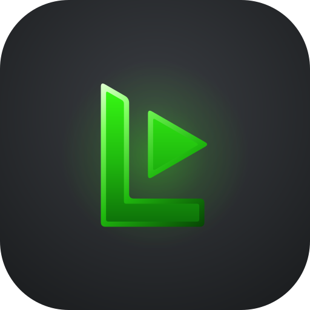

<p align="center"></p>
<h1 align="center">Loki</h1>
<p align="center">Free, ad-free video and music streaming for Android, with a big-button driving mode.</p>

Loki plays online video and audio without ads, without an account, and without Google's
services. It is a fork of [NewPipe](https://github.com/TeamNewPipe/NewPipe).

## What Loki adds

- **Driving mode.** A full-screen, audio-only screen made for quick use at a glance:
  - three giant tap zones for previous, play/pause and next
  - a large shuffle button
  - swipe right or left to skip forward or back
  - the screen stays awake, and nothing on it needs careful aiming
- **Its own look.** Charcoal grey with a neon green gradient, and its own logo and icon.

Everything else works as it does in NewPipe: search, the player, downloads, subscriptions,
playlists and settings. Loki can import a backup made by NewPipe (Settings > Backup and restore).

## Based on NewPipe

Loki is built on the work of Team NewPipe and its contributors. Loki is an independent project
and is not affiliated with or endorsed by NewPipe. Please do not send Loki bug reports or
questions to the NewPipe team.

What Loki changes on top of NewPipe is listed in [CHANGELOG.md](/CHANGELOG.md).

## Building

You need Java 21 and the Android SDK.

```
./gradlew :app:assembleDebug
```

The app file is written to `app/build/outputs/apk/debug/app-debug.apk`.

## Before publishing

A few things are left empty on purpose and must be filled in first:

| What | Where |
|---|---|
| Where crash reports go (email and/or issue page) | `ERROR_EMAIL_ADDRESS` and `ERROR_GITHUB_ISSUE_URL` in `app/src/main/java/org/schabi/newpipe/error/ErrorActivity.kt` |
| Privacy policy page | `privacy_policy_url` in `app/src/main/res/values/donottranslate.xml` |
| The app's permanent ID (cannot change after the first release) | `applicationId` in `app/build.gradle.kts` |
| Screenshots for the store listing | `fastlane/metadata/android/en-US/images/` |

## Keeping up with NewPipe

Loki keeps NewPipe's code structure so that new NewPipe releases can be merged in. A merge
brings NewPipe's name back in places, so run the rebrand script afterwards:

```
git fetch upstream
git merge upstream/master
node assets/loki_rebrand.mjs
```

The logo files are drawn by `node assets/loki_logo_generator.mjs`.

## License

Loki is free software under the [GNU General Public License v3.0 or later](/LICENSE), the same
licence as NewPipe. You may use, study, share and improve it, as long as you pass on the same
freedoms and make your source code available.
